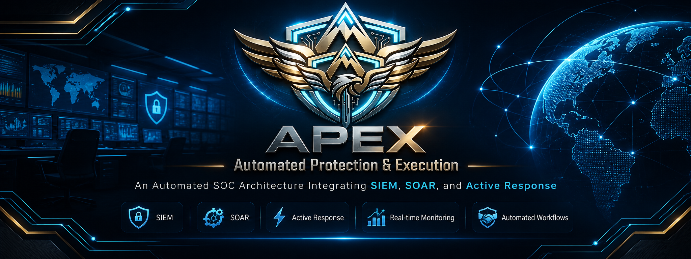

# APEX – Automated Protection & Execution

### An Automated SOC Architecture Integrating SIEM, SOAR, and Active Response

APEX is an automated Security Operations Center (SOC) architecture designed to go beyond traditional threat detection by enabling intelligent incident analysis, risk-based decision-making, and automated security response.

## Key Features

- Real-time security monitoring and threat detection.
- Automated incident aggregation and correlation.
- Risk-based policy evaluation.
- SOAR-based workflow orchestration.
- Automated and analyst-approved security responses.
- Response execution tracking and verification.

## Architecture Overview

APEX is designed as a segmented SOC architecture consisting of four security zones:

- **LAN:** Internal network and protected endpoints.
- **DMZ:** Hosts externally accessible services.
- **Honeypot:** Detects suspicious activities and attacker behavior.
- **Security Management:** Hosts the SOC components responsible for monitoring, analysis, orchestration, and response.

### Incident Response Workflow

1. **Detection:** Wazuh SIEM collects security events and generates alerts based on detection rules.
2. **Incident Aggregation:** Related alerts are correlated and grouped into security incidents.
3. **Risk Assessment:** The Policy Engine evaluates incident severity and determines the appropriate response.
4. **Orchestration:** Shuffle SOAR coordinates the response workflow.
5. **Active Response:** Security actions are executed through integrated enforcement components, including Sophos Firewall.
6. **Execution Tracking:** Response execution is monitored and recorded for verification and auditing.

## Technologies Used

| Technology | Purpose |
|---|---|
| Wazuh | SIEM, log collection, and threat detection |
| Shuffle | SOAR and automated playbook orchestration |
| Sophos Firewall | Network security and IP blocking |
| Docker | Containerization and service deployment |
| Linux | SOC infrastructure and system administration |
| Custom Policy Engine | Risk evaluation and response decisions |
| Incident Aggregator | Alert correlation and incident management |
| Execution Tracker | Response monitoring and execution records |

## Project Demo

Watch our project demonstration:

[▶ Watch APEX Demo](https://drive.google.com/file/d/1orEl1imMay9gFzDWuTZBVXsU0Hojl9zJ/view?usp=sharing)

## Collaborators

- [Nourhan Mohamed](https://github.com/Nourhan613)
- Safaa Mohamed
- Farah Hazem
- Mostafa Boghdady
- Mohamed Rabie
- Yahia Refat
